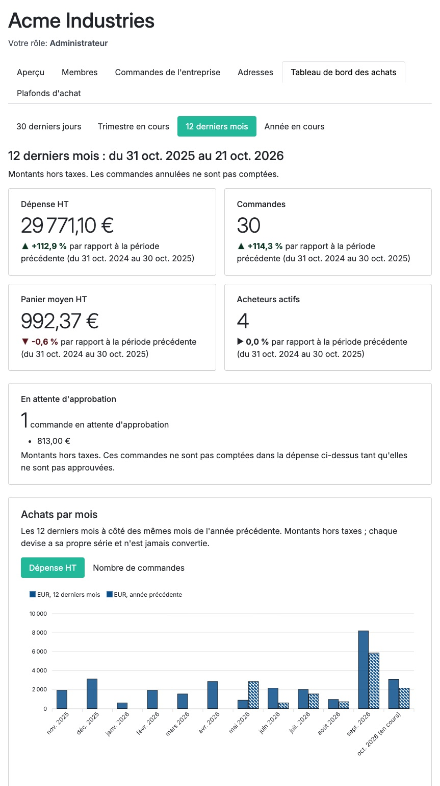
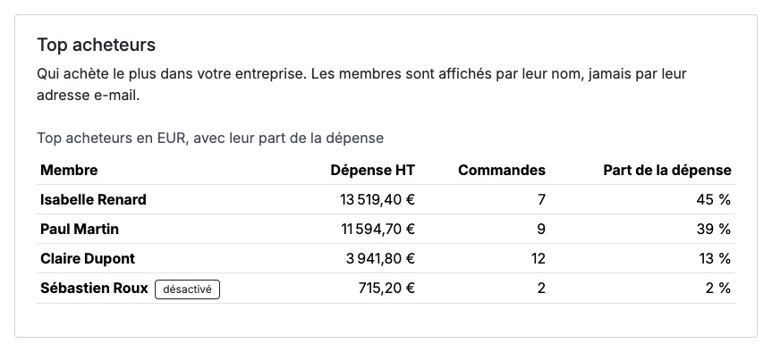
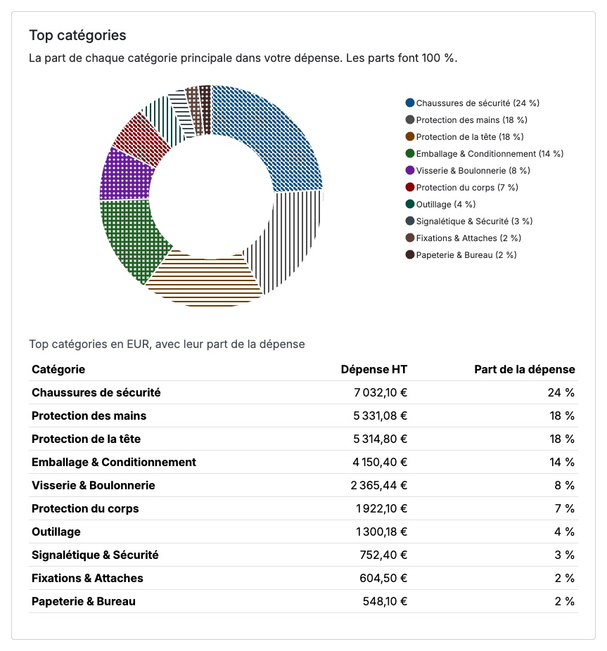
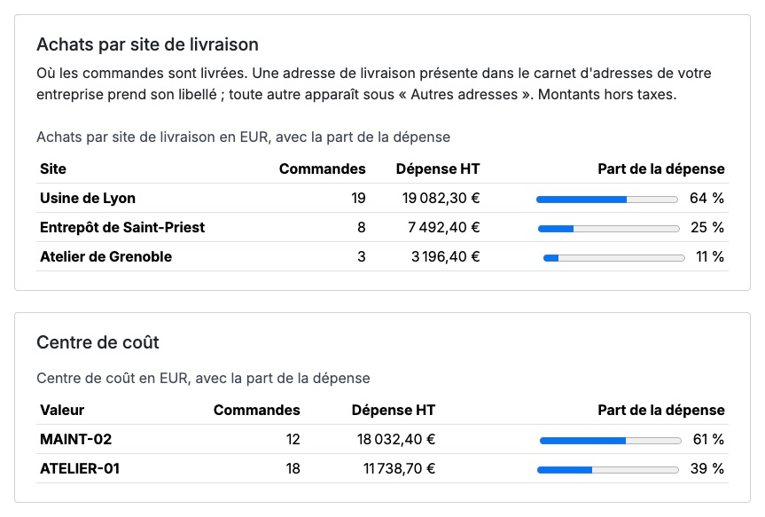
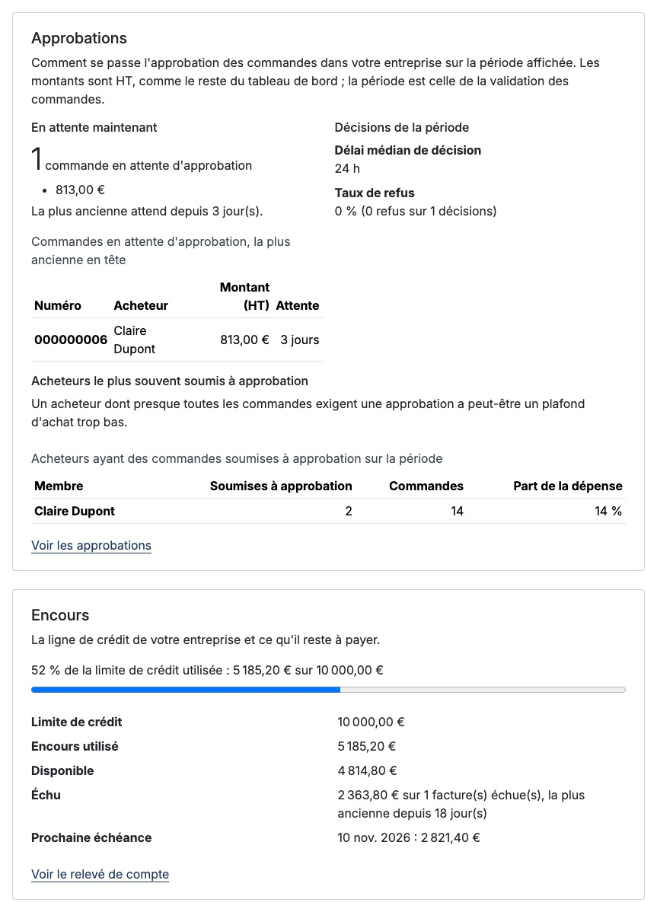

# Sylius Company Insights Plugin

> English: [README.md](README.md) <!-- vitrine:lang -->

Tableau de bord des achats pour les comptes entreprise B2B de [Sylius](https://sylius.com) 2. L'administrateur d'une entreprise voit, dans l'espace client, combien son entreprise dépense et à quel rythme elle commande : dépense, nombre de commandes, panier moyen et acheteurs actifs de la période choisie, chacun avec sa variation par rapport à la période précédente de même durée, et les commandes en attente d'approbation à part.

Construit sur [`tmonier/sylius-company-accounts-plugin`](https://github.com/thibmonier/sylius-company-accounts-plugin) (entreprises, membres, rôles, commandes de l'entreprise).

## Ce qu'il fait

- **Page** `/{_locale}/account/company/insights`, accessible par l'onglet « Tableau de bord des achats » de l'espace « Mon entreprise ».
- **Indicateurs** de la période, avec la variation en pourcentage par rapport à la période précédente de même durée :
  - dépense HT ;
  - nombre de commandes ;
  - panier moyen HT ;
  - acheteurs actifs (clients ayant passé au moins une commande) ;
  - commandes en attente d'approbation (nombre et montant), affichées à part et non comptées dans la dépense.
- **Périodes** : 30 derniers jours, trimestre en cours, 12 derniers mois (par défaut : le mois civil en cours et les 11 précédents), année en cours. La période figure dans le titre et dans l'URL (`?period=current_quarter`). Le trimestre et l'année en cours sont comparés aux mêmes jours écoulés du trimestre et de l'année précédents.
- **Achats par mois** : graphique en barres de la dépense des 12 derniers mois à côté des mêmes mois de l'année précédente. Une bascule (`?metric=amount|orders`, liste blanche) affiche le nombre de commandes au lieu du montant.
  - Les mois sans commande sont à zéro, jamais des trous ; le mois en cours est marqué « en cours » et n'est pas un mois complet.
  - Les mois suivent un fuseau horaire : celui de PHP par défaut, ou le paramètre `tmonier_company_insights.timezone` (par exemple `Europe/Paris` ; les canaux Sylius n'ont pas de fuseau propre). Une commande passée le 31 à 23 h 30 compte dans le bon mois, heure d'été comprise.
  - Une série par devise, aucune conversion et aucun total qui mélange les devises.
  - Les 12 barres totalisent la dépense de l'indicateur « 12 derniers mois » (mêmes commandes, mêmes règles).
  - Accessibilité : un tableau de données (mois, dépense, commandes, mêmes chiffres de l'année précédente, en-têtes `th scope`) est placé sous le graphique et c'est lui que lisent les lecteurs d'écran ; le dessin est `aria-hidden`. Les séries se distinguent par le remplissage (plein / hachuré) et la légende, pas par la couleur seule ; les couleurs ont un contraste d'au moins 7:1 sur fond blanc.
  - Pas de CDN ni de script en ligne : les données sont dans des attributs `data-*` lus par un contrôleur Stimulus (voir [ADR-0001](docs/adr/0001-charts-library.md)). Sans JavaScript, le tableau reste.
- **Classements** de la période choisie, sous le graphique, un jeu par devise, chacun limité à 10 lignes avec un lien « Voir tout » vers sa propre page paginée (`/account/company/insights/{buyers|products|categories}`, 25 lignes par page, `?page=`, `?currency=`) :
  - **Top acheteurs** : membre, dépense HT, nombre de commandes et part de la dépense. Un membre désactivé depuis ses commandes reste dans la liste avec la mention « désactivé ».
  - **Top produits** (variantes) : code et nom, quantité, dépense HT et date du dernier achat. Classés par dépense par défaut, par quantité avec `?sort=quantity` (liste blanche). Le nom est celui de la langue de la page ; sans traduction, le code est affiché.
  - **Top catégories** (catégorie principale du produit) : dépense et part, avec un anneau et son tableau équivalent. Toutes les catégories sont lues, donc les parts font 100 % (plus fort reste) ; la ligne « autres catégories » complète une liste courte et les produits sans catégorie forment une ligne à part.
  - Mêmes commandes que les indicateurs. Une ligne compte pour son montant HT après remises de ligne (les acheteurs utilisent le total HT de la commande, donc leur total est la dépense de l'indicateur). Une devise n'est jamais additionnée à une autre.
  - Accessibilité : chaque classement est un tableau avec légende et en-têtes `th scope` ; l'anneau est `aria-hidden`, ses parts se distinguent par des motifs de remplissage et la légende (avec la part), pas par la couleur seule, et les couleurs ont un contraste d'au moins 7:1 sur blanc.
  - **Données personnelles** : seuls le prénom et le nom d'un membre sont lus et affichés. Aucune adresse e-mail, aucun téléphone ni adresse n'est sélectionné par les requêtes ni présent dans le HTML. L'entreprise est celle du membre connecté ; le classement (`buyers|products|categories`), le tri, la page et la devise sont contrôlés par liste blanche ou motif strict, et toute autre valeur donne la valeur par défaut ou un 404.
- **Filtres** (`?member=`, `?site=`, `?from=&to=`), appliqués à tout le tableau de bord (indicateurs, graphique, classements, ventilation) et à l'export : un membre de l'entreprise, un site de livraison, et une période personnalisée de deux dates (qui remplace la période choisie plus haut, comparée à la période de même durée juste avant). Le membre et le site sont contrôlés contre les membres et le carnet d'adresses de l'entreprise du membre connecté ; toute autre valeur est ignorée.
- **Achats par site de livraison** : la dépense de chaque adresse de livraison avec la part de chacune. Une adresse présente dans le carnet d'adresses de l'entreprise (`tmonier/sylius-company-accounts-plugin`) prend son libellé ; toute autre adresse, et une commande sans adresse, est regroupée sous « Autres adresses ». L'adresse d'une commande est une copie de celle choisie dans le carnet : les deux sont rapprochées sur la rue, le code postal, la ville et le pays.
- **Achats par axe analytique** (centre de coût, projet...) : un bloc par axe fourni par l'application via `OrderDimensionProviderInterface` (voir plus bas). Le plugin n'en fournit aucun, et sans axe aucun bloc de ce type n'est affiché.
- **Export CSV** de la sélection (`/account/company/insights/export`, même permission et mêmes filtres que le tableau de bord) : voir plus bas.
- **Widgets des plugins compagnons** (approbations, encours) : voir plus bas.
- **Accès** : administrateurs de l'entreprise uniquement (`COMPANY_VIEW_INSIGHTS`). Les acheteurs et les approbateurs reçoivent un 403 expliqué et n'ont pas l'onglet.
- **Cloisonnement entre entreprises** : l'entreprise est celle du membre connecté, jamais un paramètre de la requête. Les paramètres (période, membre, site, dates) sont contrôlés contre une liste blanche, un motif strict ou les membres et le carnet d'adresses de cette entreprise ; toute autre valeur est ignorée.
- **Commandes comptées** : checkout terminé, non annulées, rattachées à l'entreprise par `CompanyOrder`, non en attente d'approbation.
- **Montants** hors taxes, dans la devise de la commande. Avec plusieurs devises, il y a une ligne par devise et rien n'est converti.
- Les agrégats sont calculés par la base de données (aucune entité chargée) en SQL standard : MySQL, MariaDB et PostgreSQL.
- Libellés en français et en anglais. La page ne repose pas sur la couleur seule (flèches et phrases) et évite les classes de texte peu contrastées.

## Ventilation, filtres et export CSV

Les filtres sont au-dessus des chiffres (membre, site de livraison, deux dates, « Appliquer » / « Réinitialiser »). L'URL les porte (`?member=12&site=3&from=2026-03-01&to=2026-03-31`) : un lien peut être partagé dans l'entreprise, et chaque lien de la page les conserve.

L'export compte **une ligne par ligne de commande**, hors taxes, pour la sélection (mêmes commandes que les indicateurs : finalisées, non annulées, pas en attente d'approbation) :

| Colonne | Contenu |
|---------|---------|
| Date | jour de la validation, dans le fuseau du rapport |
| Numéro | numéro de commande |
| Référence PO | `OrderReferenceProviderInterface` (vide sans fournisseur) |
| Acheteur | prénom et nom |
| Site | libellé du carnet d'adresses, sinon l'adresse de livraison |
| *(axe)* | une colonne par `OrderDimensionProviderInterface`, titrée par son libellé |
| Code produit, Nom du produit | code de la variante ; nom du produit (et de la variante si différent) |
| Quantité, PU HT, Total HT | le total est la ligne après les remises de la ligne ; le PU est ce total divisé par la quantité. Les ajustements de la commande (livraison, remise de commande) ne sont pas dans les lignes |
| Devise | une devise par ligne, jamais additionnées |

- **Format** : UTF-8 avec marque d'ordre des octets et `;` comme séparateur, virgule décimale, pour qu'un tableur en français l'ouvre directement avec les bons accents.
- **Limites** : 24 mois et 50 000 lignes au plus. Au-delà, aucun fichier n'est produit (HTTP 422) et la page invite à réduire la période ; le lien d'export est remplacé par ce message quand la période est déjà trop longue.
- **Formules** : une cellule de texte qui commence par `=`, `+`, `-`, `@`, une tabulation ou un retour chariot est préfixée d'une apostrophe, pour rester du texte dans le tableur. Cela couvre tous les textes (référence, acheteur, site, valeur d'axe, produit).
- **Journal** : chaque export est journalisé au niveau `info` (entreprise, identifiant du membre, période, nombre de lignes, heure), sans contenu : ni nom, ni référence, ni numéro de commande.
- **Accès** : `COMPANY_VIEW_INSIGHTS`, comme la page. L'entreprise vient du membre connecté ; les filtres sont contrôlés contre ses membres et son carnet d'adresses.

### Points d'extension

```php
use Tmonier\SyliusCompanyInsightsPlugin\Breakdown\OrderDimensionProviderInterface;

final class CostCenterDimension implements OrderDimensionProviderInterface
{
    public function code(): string { return 'cost-center'; }          // lettres, chiffres, tirets
    public function label(): string { return 'app.insights.cost_center'; } // clé de traduction ou texte simple

    public function values(array $orderIds): array // id de commande => valeur, en un appel pour toutes les commandes
    {
        // ex. SELECT id, cost_center FROM sylius_order WHERE id IN (...)
    }
}
```

Les services qui implémentent `OrderDimensionProviderInterface` ou `OrderReferenceProviderInterface` sont étiquetés par autoconfiguration (`tmonier_company_insights.order_dimension_provider`, `tmonier_company_insights.order_reference_provider`) ; sinon, étiquetez-les à la main. Un axe renvoie la valeur des commandes demandées (1 000 identifiants au plus à la fois) et rien ne suppose d'où elle vient. Une commande sans valeur est regroupée sous « Non renseigné ». Un fournisseur qui lève une exception est journalisé et son bloc est omis ; le reste de la page demeure. Avec plusieurs fournisseurs de référence, chaque commande prend la première référence non vide dans l'ordre des services (`priority` de l'étiquette, la plus haute d'abord).

## Widgets des plugins compagnons

Le tableau de bord affiche les blocs des plugins avec lesquels il sait dialoguer, **détectés à la construction du conteneur** : un compagnon non installé n'a pas de widget, pas d'erreur et pas de dépendance (`composer.json` ne fait que les *suggérer*).

| Widget | Compagnon | Chiffres (services publics du compagnon) |
|--------|-----------|------------------------------------------|
| **Approbations** | [`tmonier/sylius-purchase-approval-plugin`](https://github.com/thibmonier/sylius-purchase-approval-plugin) | commandes en attente (nombre, montant, la plus ancienne en tête avec son ancienneté), délai médian de décision, taux de refus de la période, acheteurs le plus souvent soumis à approbation (signe d'un plafond peut-être trop bas), lien vers les approbations |
| **Encours** | [`tmonier/sylius-trade-credit-plugin`](https://github.com/thibmonier/sylius-trade-credit-plugin) | limite de crédit, encours utilisé, disponible, montant et nombre de factures échues, prochaine échéance, jauge d'utilisation (`progress` avec son équivalent textuel), lien vers le relevé ; « Pas de compte de paiement à terme » pour une entreprise sans compte |

- Les chiffres de l'encours viennent du `StatementBuilder` du compagnon. Le plugin d'approbation n'a pas d'agrégat pour le délai médian, le taux de refus et les acheteurs : ce sont des agrégats SQL sur sa table `tmonier_purchase_approval_order_approval` (entreprise du membre connecté uniquement, paramètres liés, sans plafond ; MySQL, MariaDB et PostgreSQL), le pont n'étant chargé que si le compagnon est installé. La période des approbations est celle de la validation de la commande (`checkout_completed_at`), comme les commandes comptées partout ailleurs. Taux de refus = refusées sur approuvées et refusées ; une demande expirée ou annulée n'est pas une décision. La part des « acheteurs » est le nombre d'approbations rapporté aux commandes que l'acheteur a validées dans la période. Les montants des approbations sont HT, comme le reste du tableau de bord (les approbateurs voient le montant TTC dans leur propre liste) ; les chiffres de l'encours sont ceux du relevé.
- Le lien vers les approbations n'apparaît que si purchase-approval laisse le membre les ouvrir (par défaut ses approbateurs : `approver_roles`).
- Un widget dont le service lève une exception affiche « Données momentanément indisponibles » et les autres demeurent ; l'erreur est journalisée avec le nom du widget et la classe de l'exception, sans message, trace ni donnée personnelle.
- Les widgets sont ceux de l'entreprise ; les filtres membre, site et période personnalisée ne les restreignent pas (une ligne de crédit ou une file d'approbations n'est pas une affaire de site), la période restreint en revanche les chiffres des approbations.

Votre propre widget implémente `InsightsWidgetProviderInterface` (`code()`, `title()`, `permission()`, `provide(WidgetContext)`) et renvoie un `InsightsWidget` (un gabarit Twig et ses données) ou `null` ; étiquetez-le `tmonier_company_insights.widget_provider` (autoconfiguré). `permission()` est un attribut de sécurité contrôlé sur l'entreprise avant le calcul du widget (`null` : la permission du tableau de bord suffit). Les passerelles vivent sous `Tmonier\SyliusCompanyInsightsPlugin\Bridge`.

## Captures d'écran

Données de démonstration de [sylius-b2b-demo](https://github.com/thibmonier/sylius-b2b-demo), connecté en administratrice de l'entreprise.











## Installation

```bash
composer require tmonier/sylius-company-insights-plugin
```

1. Déclarer le bundle (après `TmonierSyliusCompanyAccountsPlugin`) dans `config/bundles.php` :

    ```php
    Tmonier\SyliusCompanyInsightsPlugin\TmonierSyliusCompanyInsightsPlugin::class => ['all' => true],
    ```

2. Importer la configuration dans `config/packages/_sylius.yaml` :

    ```yaml
    imports:
        - { resource: "@TmonierSyliusCompanyInsightsPlugin/config/config.yaml" }
    ```

3. Importer les routes dans `config/routes.yaml` :

    ```yaml
    tmonier_sylius_company_insights:
        resource: "@TmonierSyliusCompanyInsightsPlugin/config/routes.yaml"
    ```

4. Exécuter la migration (un index sur `tmonier_company_order`, déclaré dans le mapping Doctrine pour que les diffs de schéma le conservent) :

    ```bash
    bin/console doctrine:migrations:migrate
    ```

5. Construire le graphique (facultatif, les tableaux fonctionnent sans). Ajoutez la dépendance `apexcharts` (déjà utilisée par l'administration Sylius) et importez le point d'entrée du plugin dans `assets/shop/entrypoint.js` de votre boutique :

    ```js
    import '@vendor/tmonier/sylius-company-insights-plugin/assets/shop/entrypoint';
    ```

Le fuseau horaire des mois se règle par un paramètre (par défaut : celui de PHP) :

```yaml
parameters:
    tmonier_company_insights.timezone: 'Europe/Paris'
```

Le contrôle d'accès de la boutique Sylius doit protéger `^/(?:[a-z]{2,4}(?:_[A-Za-z]{2})?)/account` (c'est le cas dans la configuration Sylius par défaut).

## Permission

| Attribut | Sujet | Accordée à |
|----------|-------|------------|
| `COMPANY_VIEW_INSIGHTS` | entreprise | un membre actif au rôle `admin` de l'entreprise active, pour cette entreprise seulement |

```twig
...
```

## Commandes en attente d'approbation

Avec [`tmonier/sylius-purchase-approval-plugin`](https://github.com/thibmonier/sylius-purchase-approval-plugin) installé, les commandes qu'il retient apparaissent dans leur propre bloc et ne comptent pas dans la dépense tant qu'un approbateur ne les a pas approuvées. Sans lui, le bloc indique qu'aucune commande n'est en attente. Il n'y a pas de dépendance dure : l'intégration est un port (`PendingOrderConditionInterface`) que l'on peut implémenter pour un autre circuit d'approbation en redéfinissant le service `tmonier_company_insights.pending_order_condition`.

## Versions supportées (PHP, Symfony, Sylius) et impact de version

| | Supporté |
|-|----------|
| PHP | 8.2, 8.3, 8.4, 8.5 |
| Symfony | 6.4, 7.4, 8.0 |
| Sylius | 2.2 (`~2.2.0`), 2.3 (`~2.3.0`) |
| Base de données | MySQL 8.4, MariaDB 11.4, PostgreSQL 17 |
| Dépendance | `tmonier/sylius-company-accounts-plugin` ^1.1 |
| Optionnels | `tmonier/sylius-purchase-approval-plugin` ^1.1 (approbations), `tmonier/sylius-trade-credit-plugin` ^1.1 (encours) |

La matrice de CI est celle de `tmonier/sylius-company-accounts-plugin` et de `tmonier/sylius-agentic-feeds-plugin` : Sylius 2.2 sur PHP 8.2 à 8.4 avec Symfony 6.4 et 7.4, Sylius 2.3 sur PHP 8.3 et 8.4 avec Symfony 6.4, 7.4 et 8.0, plus des cellules MariaDB et PostgreSQL. PHP 8.5 tourne sur Sylius 2.3 avec Symfony 8. Impact de version : aucun code du plugin ne dépend d'une API propre à une version ; le voter garde la signature `mixed $vote = null` valable de Symfony 6.4 à 8.0 et le SQL est portable (aucune fonction de date propre à un moteur ; l'export diffuse les lignes en flux et appelle `fputcsv` avec un caractère d'échappement vide explicite, valide dès PHP 8.2).

## Développement

```bash
composer install
vendor/bin/ecs check
vendor/bin/phpstan analyse            # niveau max
vendor/bin/rector process --dry-run
vendor/bin/phpunit --testsuite unit
vendor/bin/phpunit --testsuite non-unit   # nécessite la base de test, voir le Makefile
```

Les décisions de conception sont consignées dans [`docs/adr`](docs/adr).

<!-- vitrine:demo-b2b:start -->
## Démo B2B

Ce plugin est utilisé dans la [démo B2B Sylius](https://github.com/thibmonier/sylius-b2b-demo) : une boutique Sylius 2.3 avec des données d'exemple fictives, où les plugins B2B fonctionnent ensemble. Le code source, l'installation et les fixtures de la démo sont dans ce dépôt.

- Démo en ligne : [sylius-b2b.thibaut-monier.fr](https://sylius-b2b.thibaut-monier.fr)
- Auteur : [Thibaut Monier](https://www.linkedin.com/in/thibautmonier/)

La démo est un exemple, pas une configuration de production.
<!-- vitrine:demo-b2b:end -->

## Licence

MIT
