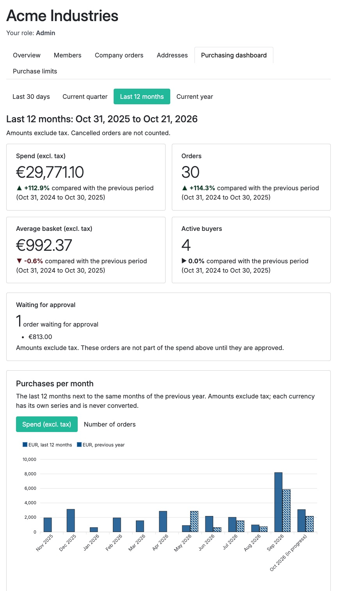
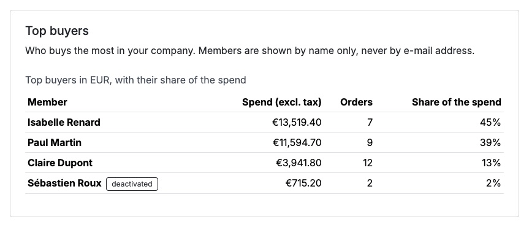
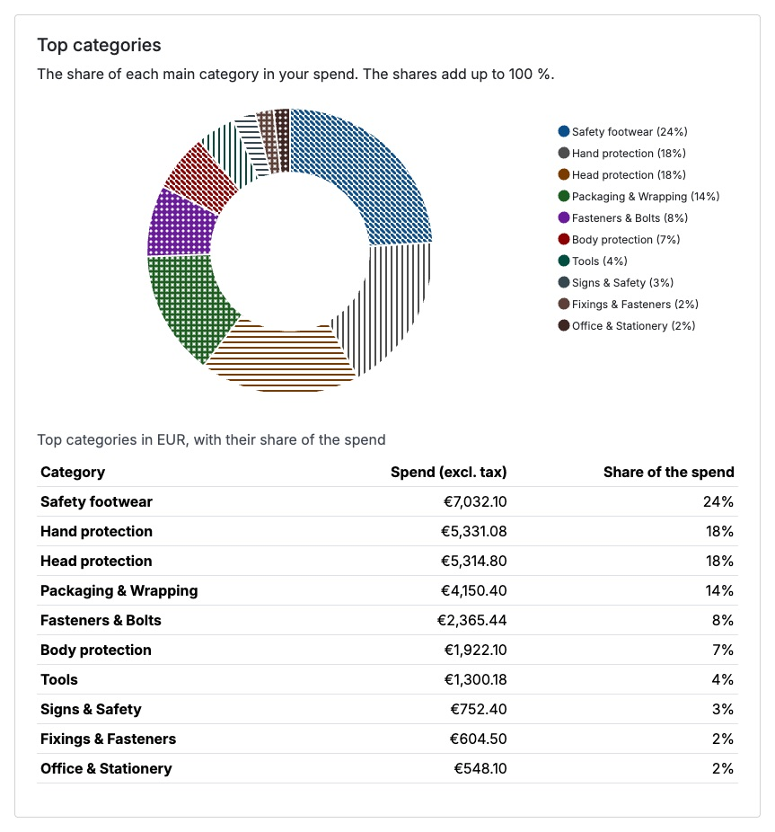

# Sylius Company Insights Plugin

Purchasing dashboard for [Sylius](https://sylius.com) 2 B2B company accounts. The administrator of a company sees, in the customer account, how much the company spends and how fast it orders: spend, number of orders, average basket and active buyers of the chosen period, each with its variation against the previous period of the same duration, and the orders waiting for approval apart.

Built on [`tmonier/sylius-company-accounts-plugin`](https://github.com/thibmonier/sylius-company-accounts-plugin) (companies, members, roles, company orders). English | [Français](README.fr.md)

## What it does

- **Page** `/{_locale}/account/company/insights`, linked from a "Purchasing dashboard" tab of the "My company" area.
- **Indicators** of the period, with the variation in percent against the previous period of the same duration:
  - spend, tax exclusive;
  - number of orders;
  - average basket, tax exclusive;
  - active buyers (customers with at least one order);
  - orders waiting for approval (number and amount), shown apart and not counted in the spend.
- **Periods**: last 30 days, current quarter, last 12 months (default, the current calendar month and the 11 before it), current year. The period is in the title and in the URL (`?period=current_quarter`). The quarter and the year so far are compared with the same elapsed days of the previous quarter and year.
- **Purchases per month**: bar chart of the spend of the last 12 months next to the same months of the previous year. A switch (`?metric=amount|orders`, allow-listed) shows the number of orders instead of the amount.
  - Months without order are zeros, never gaps; the month in progress is marked "in progress" and is not a complete month.
  - Months follow a timezone: the default timezone of PHP, or the parameter `tmonier_company_insights.timezone` (for example `Europe/Paris`; Sylius channels have no timezone of their own). An order placed on the 31st at 23:30 counts in the right month, summer time included.
  - One series per currency, no conversion and no total mixing currencies.
  - The 12 bars add up to the spend of the "last 12 months" indicator (same orders, same rules).
  - Accessibility: a data table (month, spend, orders, same figures of the previous year, with `th scope` headers) sits under the chart and is what screen readers read; the drawing is `aria-hidden`. Series differ by fill (solid / hatched) and legend, not by colour alone; colours are at least 7:1 against white.
  - No CDN and no inline script: the data is in `data-*` attributes read by a Stimulus controller (see [ADR-0001](docs/adr/0001-charts-library.md)). Without JavaScript, the table remains.
- **Rankings** of the chosen period, under the chart, one set per currency, each limited to 10 rows with a "See all" link to its own paginated page (`/account/company/insights/{buyers|products|categories}`, 25 rows per page, `?page=`, `?currency=`):
  - **Top buyers**: member, tax-exclusive spend, number of orders and share of the spend. A member deactivated since his orders stays in the list with a "deactivated" mention.
  - **Top products** (variants): code and name, quantity, tax-exclusive spend and date of the last purchase. Ranked by spend by default, by quantity with `?sort=quantity` (allow-listed). The name is the one of the language of the page; without translation the code is shown.
  - **Top categories** (main category of the product): spend and share, with a donut and its equivalent table. All the categories are read, so the shares add up to 100 % (largest remainder); the "other categories" row completes a short list and the products without category are a row of their own.
  - Same orders as the indicators. A line counts for its tax-exclusive total after the discounts of the line (the buyers use the tax-exclusive total of the order, so their total is the spend of the indicator). A currency is never added to another.
  - Accessibility: each ranking is a table with a caption and `th scope` headers; the donut is `aria-hidden`, its slices differ by fill pattern and legend (with the share), not by colour alone, and the colours are at least 7:1 against white.
  - **Personal data**: only the first and the last name of a member are read and shown. No e-mail address, phone number or address is selected by the queries nor present in the HTML. The company is the one of the signed-in member; the ranking (`buyers|products|categories`), the sort, the page and the currency are checked against an allow-list or a strict pattern, and any other value gives the default or a 404.
- **Filters** (`?member=`, `?site=`, `?from=&to=`), applied to the whole dashboard (indicators, chart, rankings, breakdown) and to the export: a member of the company, a delivery site, and a custom period of two dates (which replaces the period chosen above, compared with the period of the same duration just before). The member and the site are checked against the members and the address book of the company of the signed-in member; any other value is ignored.
- **Purchases per delivery site**: the spend of each delivery address with the share of each. An address that is in the address book of the company (`tmonier/sylius-company-accounts-plugin`) takes its label; any other address, and an order without address, is gathered under "Other addresses". An order address is a copy of the one picked in the address book, so both are matched on street, postcode, city and country.
- **Purchases per analytical axis** (cost centre, project...): one block per axis supplied by the application through `OrderDimensionProviderInterface` (see below). The plugin ships none, and without any axis no such block is shown.
- **CSV export** of the selection (`/account/company/insights/export`, same permission and same filters as the dashboard): see below.
- **Widgets of the companion plugins** (approvals, credit): see below.
- **Access**: company administrators only (`COMPANY_VIEW_INSIGHTS`). Buyers and approvers get an explained 403 and no tab.
- **Isolation between companies**: the company is the one of the signed-in member, never a request parameter. The parameters (period, member, site, dates) are checked against an allow-list, a strict pattern or the members and the address book of that company; any other value is ignored.
- **Counted orders**: checkout completed, not cancelled, linked to the company by `CompanyOrder`, not waiting for approval.
- **Amounts** are tax exclusive, in the currency of the order. With several currencies, there is one line per currency and nothing is converted.
- Aggregates are computed by the database (no entity loaded) on plain SQL: MySQL, MariaDB and PostgreSQL.
- Labels in English and French. The page does not rely on colour alone (arrows and sentences) and avoids low-contrast text classes.

## Breakdown, filters and CSV export

The filters sit above the figures (member, delivery site, two dates, "Apply" / "Reset"). The URL carries them (`?member=12&site=3&from=2026-03-01&to=2026-03-31`), so a link can be shared inside the company; every link of the page keeps them.

The export has **one line per order line**, tax exclusive, for the selection (same orders as the indicators: completed, not cancelled, not waiting for approval):

| Column | Content |
|--------|---------|
| Date | day of the checkout, in the report timezone |
| Number | order number |
| PO reference | `OrderReferenceProviderInterface` (empty without provider) |
| Buyer | first and last name |
| Site | label of the address book, else the delivery address |
| *(axis)* | one column per `OrderDimensionProviderInterface`, headed by its label |
| Product code, Product name | code of the variant; product name (and variant name when different) |
| Quantity, Unit price excl. tax, Total excl. tax | the total is the line after the discounts of the line; the unit price is that total divided by the quantity. Order-level adjustments (shipping, order discount) are not in the lines |
| Currency | one currency per line, never added together |

- **Format**: UTF-8 with a byte order mark and `;` as separator, decimal comma, so that a French spreadsheet opens it directly with the right accents.
- **Limits**: 24 months and 50 000 lines at most. Beyond, no file is produced (HTTP 422) and the page invites to reduce the period; the export link is replaced by the same message when the period is already too long.
- **Formulas**: a text cell that starts with `=`, `+`, `-`, `@`, a tab or a carriage return is prefixed with an apostrophe, so that it stays text in the spreadsheet. This covers every text (reference, buyer, site, axis value, product).
- **Log**: each export is logged at `info` level (company, member id, period, number of lines, time), with no content: no name, reference or order number.
- **Access**: `COMPANY_VIEW_INSIGHTS`, like the page. The company comes from the signed-in member; the filters are checked against its members and address book.

### Extension points

```php
use Tmonier\SyliusCompanyInsightsPlugin\Breakdown\OrderDimensionProviderInterface;

final class CostCenterDimension implements OrderDimensionProviderInterface
{
    public function code(): string { return 'cost-center'; }          // letters, digits, dashes
    public function label(): string { return 'app.insights.cost_center'; } // a translation key or a plain text

    public function values(array $orderIds): array // order id => value, in one call for all the orders
    {
        // e.g. SELECT id, cost_center FROM sylius_order WHERE id IN (...)
    }
}
```

Services implementing `OrderDimensionProviderInterface` or `OrderReferenceProviderInterface` are tagged by autoconfiguration (`tmonier_company_insights.order_dimension_provider`, `tmonier_company_insights.order_reference_provider`); tag them by hand otherwise. A dimension returns the value for the orders it is asked about (never more than 1 000 ids at a time) and nothing is assumed about where it comes from. An order without value is gathered under "Not set". A provider that raises is logged and its block is left out; the rest of the page stays. With several reference providers, each order takes the first non-empty reference in the order of the services (tag `priority`, highest first).

## Widgets of the companion plugins

The dashboard shows the blocks of the plugins it can talk to, **detected at container build time**: a companion that is not installed has no widget, no error and no dependency (`composer.json` only *suggests* them).

| Widget | Companion | Figures (public services of the companion) |
|--------|-----------|--------------------------------------------|
| **Approvals** | [`tmonier/sylius-purchase-approval-plugin`](https://github.com/thibmonier/sylius-purchase-approval-plugin) | orders waiting (number, amount, the oldest first with their age), median time to decide, refusal rate of the period, buyers whose orders are most often submitted to approval (a sign that their limit may be too low), link to the approvals |
| **Credit** | [`tmonier/sylius-trade-credit-plugin`](https://github.com/thibmonier/sylius-trade-credit-plugin) | credit limit, amount used, available, overdue amount and invoices, next due date, a usage gauge (`progress` with its text equivalent), link to the statement; "No payment-on-account line" for a company without account |

- The figures come from the repository (approvals) and the `StatementBuilder` (credit) of the companions, never from their tables. The plugin has no aggregate for the median time, the refusal rate and the buyers of the approvals: they are computed from the approvals of the period (the 2 000 latest at most). Refusal rate = refused out of approved and refused; expired and cancelled requests are not decisions. The "buyers" share is the number of approvals out of the orders the buyer sent through the checkout in the period. The amounts of the requests include tax, as the approvers see them; the credit figures are the ones of the statement.
- The link to the approvals only appears when purchase approval lets the member open them (by default its approvers: `approver_roles`).
- A widget whose service raises shows "Data temporarily unavailable" and the others stay; the error is logged with the name of the widget and the class of the exception, with no message, trace or personal data.
- The widgets are those of the company; the member, site and custom-period filters do not narrow them (a credit line or a queue of approvals is not a matter of site), the period does narrow the approval figures.

Your own widget implements `InsightsWidgetProviderInterface` (`code()`, `title()`, `permission()`, `provide(WidgetContext)`) and returns an `InsightsWidget` (a Twig template and its data) or `null`; tag it `tmonier_company_insights.widget_provider` (autoconfigured). `permission()` is a security attribute checked against the company before the widget is computed (`null`: the permission of the dashboard is enough). Bridges live under `Tmonier\SyliusCompanyInsightsPlugin\Bridge`.

## Screenshots

Demo data of [sylius-b2b-demo](https://github.com/thibmonier/sylius-b2b-demo), signed in as the administrator of the company.







## Installation

```bash
composer require tmonier/sylius-company-insights-plugin
```

1. Register the bundle (after `TmonierSyliusCompanyAccountsPlugin`) in `config/bundles.php`:

    ```php
    Tmonier\SyliusCompanyInsightsPlugin\TmonierSyliusCompanyInsightsPlugin::class => ['all' => true],
    ```

2. Import the configuration in `config/packages/_sylius.yaml`:

    ```yaml
    imports:
        - { resource: "@TmonierSyliusCompanyInsightsPlugin/config/config.yaml" }
    ```

3. Import the routes in `config/routes.yaml`:

    ```yaml
    tmonier_sylius_company_insights:
        resource: "@TmonierSyliusCompanyInsightsPlugin/config/routes.yaml"
    ```

4. Run the migration (one index on `tmonier_company_order`, declared in the Doctrine mapping so that schema diffs keep it):

    ```bash
    bin/console doctrine:migrations:migrate
    ```

5. Build the chart (optional, the tables work without it). Add the dependency `apexcharts` (already used by the Sylius admin) and import the entrypoint of the plugin in your shop `assets/shop/entrypoint.js`:

    ```js
    import '@vendor/tmonier/sylius-company-insights-plugin/assets/shop/entrypoint';
    ```

The timezone of the months can be set with a parameter (default: the timezone of PHP):

```yaml
parameters:
    tmonier_company_insights.timezone: 'Europe/Paris'
```

The Sylius shop access control must protect `^/(?:[a-z]{2,4}(?:_[A-Za-z]{2})?)/account` (it does in the default Sylius configuration).

## Permission

| Attribute | Subject | Granted to |
|-----------|---------|------------|
| `COMPANY_VIEW_INSIGHTS` | company | an enabled member with the `admin` role of the enabled company, for that company only |

```twig
...
```

## Orders waiting for approval

With [`tmonier/sylius-purchase-approval-plugin`](https://github.com/thibmonier/sylius-purchase-approval-plugin) installed, the orders it holds are reported in their own block and are not part of the spend until an approver approves them. Without it, the block says that no order is waiting. There is no hard dependency: the integration is a port (`PendingOrderConditionInterface`) that you can implement for another approval workflow by redefining the service `tmonier_company_insights.pending_order_condition`.

## Supported versions (PHP, Symfony, Sylius) and impact of version

| | Supported |
|-|-----------|
| PHP | 8.2, 8.3, 8.4, 8.5 |
| Symfony | 6.4, 7.4, 8.0 |
| Sylius | 2.2 (`~2.2.0`), 2.3 (`~2.3.0`) |
| Database | MySQL 8.4, MariaDB 11.4, PostgreSQL 17 |
| Dependency | `tmonier/sylius-company-accounts-plugin` ^1.1 |
| Optional | `tmonier/sylius-purchase-approval-plugin` ^1.1 (approvals), `tmonier/sylius-trade-credit-plugin` ^1.1 (credit) |

The CI matrix is the one of `tmonier/sylius-company-accounts-plugin` and `tmonier/sylius-agentic-feeds-plugin`: Sylius 2.2 on PHP 8.2 to 8.4 with Symfony 6.4 and 7.4, Sylius 2.3 on PHP 8.3 and 8.4 with Symfony 6.4, 7.4 and 8.0, plus MariaDB and PostgreSQL cells. PHP 8.5 runs on Sylius 2.3 with Symfony 8. Impact of version: none of the plugin code depends on a version-specific API; the voter keeps the `mixed $vote = null` signature of the Symfony 6.4 to 8.0 range and the SQL is portable (no date function of one engine; the export streams the rows and uses `fputcsv` with an explicit empty escape character, valid from PHP 8.2).

## Development

```bash
composer install
vendor/bin/ecs check
vendor/bin/phpstan analyse            # level max
vendor/bin/rector process --dry-run
vendor/bin/phpunit --testsuite unit
vendor/bin/phpunit --testsuite non-unit   # needs the test database, see the Makefile
```

Design decisions are recorded in [`docs/adr`](docs/adr).

## License

MIT
